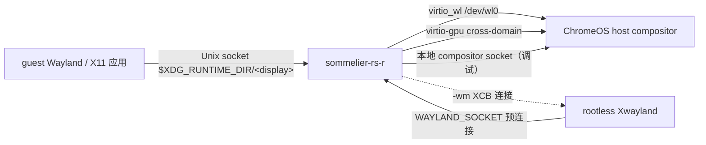
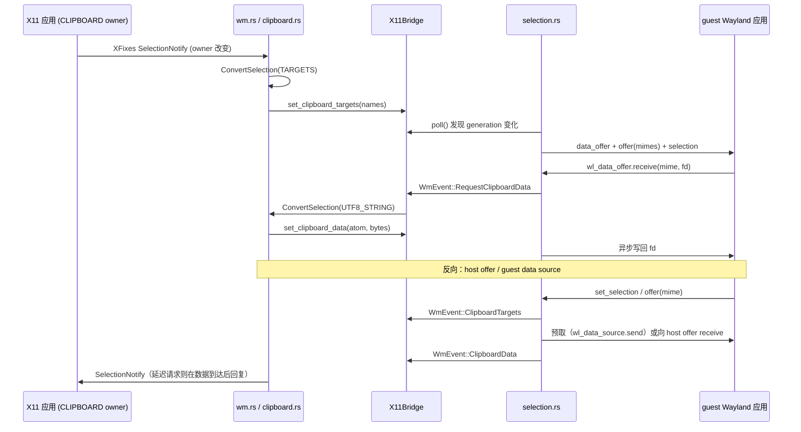

# sommelier-rs-r 架构

本文描述**当前代码**的结构。`docs/ARCHITECTURE_BASELINE.md` 是上游 `main`
分支的原始架构底稿，仅作合并参考；两分支的逐文件对比见
[`BRANCH_MERGE.md`](BRANCH_MERGE.md)，功能完成度见
[`FEATURE_MATRIX.md`](FEATURE_MATRIX.md)。

## 1. 角色与边界

`Sommelier-rs-r` 是一个**双向 Wayland 消息代理**，同时充当 guest 的
"compositor" 与 host compositor 的 "client"：



它不是 X11 字节流代理：X11 侧由真正的 Xwayland + 本进程内的 X11 WM 处理，
最终把 XID 对应到 host 侧的 `wl_surface` / `xdg_toplevel`。

## 2. 进程与线程模型

```
process
 ├─ tokio current_thread runtime                 (main.rs)
 │   ├─ listener task：accept 后 spawn_client
 │   ├─ one task per guest client                (proxy.rs::Client::run)
 │   │   └─ tokio::select! { client.recv, host.recv, wm_commands, 50ms tick }
 │   ├─ clipboard pipe pump / prefetch tasks     (tokio::spawn + blocking pool)
 │   └─ child-process reaper + sd_notify
 └─ dedicated OS thread                          (x11::wm::run)
     └─ X11 event loop (poll_for_event + flush, 2 ms)
```

- **必须用 `current_thread`**：`KeyboardHandler` 内的 `xkbcommon` 对象
  `!Send`，依赖 `unsafe impl Send`。改成多线程 runtime 会破坏该不变量。
- **X11 WM 独立 OS 线程**：`x11rb::RustConnection` 同步轮询，不占用 tokio
  runtime；通过 `X11Bridge` 的 `WmCommand` / `WmEvent` 无界通道与代理通信。
- 剪贴板管道读写用 `tokio::fs::File`（blocking pool），不会卡住事件循环。

主线程与 WM 线程之间**没有共享可变 Wayland 状态**：`Context` 属于单个
`Client` task；跨线程只走 `Arc<X11Bridge>`。剪贴板状态
`Context::selection` 是 `Arc<Mutex<SelectionBridge>>`，仅为让 handler 能同时
持有 `&mut Context`。

## 3. 三条 host 传输

`connection.rs::ConnectionTransport` 有三个变体，由
`config.rs::resolve_transport()` 选择（默认 `auto`：先 `/dev/wl0`，再
virtio-gpu render node，最后本地 socket）：

| 变体 | 设备 | 备注 |
|---|---|---|
| `VirtWayland` | `/dev/wl0` | Crostini 唯一可靠路径；`VirtWaylandChannel` 提供 `NEW_ALLOC` / `NEW_PIPE_READ` |
| `VirtGpu` | `/dev/dri/renderD*` | cross-domain blob + fence，`main` 分支能力 |
| `Unix` | `$WAYLAND_DISPLAY` | 调试 / 非 Crostini VMM |

`--force-drm-device` 同时作用于 `VirtGpuChannel::new_with_device()` 与
`Allocator::with_device()`。

## 4. 每个 guest client 一条独立 host 连接

```
Client {
  client_conn: WaylandConnection,   // guest socket
  host_conn:   WaylandConnection,   // 独立 host 连接
  ctx:         Context,             // ShadowTable + 各种 handler 状态
  handler:     SommelierHandler,    // 聚合 delegation
  wm_commands, x11, toplevels
}
```

`handle_msgs()` 逐条解析 `WireMessage`，按方向分发：

- `dispatch_request` → `protocols::all::dispatch_request()`；
- `dispatch_event` → `protocols::all::dispatch_event()`；
- `DispatchResult::UnknownOpcode` 只丢单条消息，其余 `ProtocolError` 断连；
- 两个反向队列 `host_to_client_queue` / `client_to_host_queue` 让 handler
  可以"回插"消息（合成事件、内部 bind、ack-key、剪贴板请求）；
- EOF 判定为 `bytes == 0 && read_fds.is_empty()`，避免 SCM_RIGHTS 落后于数据时误断连。

每轮循环末尾 `poll_selection()` 驱动剪贴板状态机并 flush 合成消息；
50 ms 定时器保证 X11 侧变化在 guest 空闲时也能生效。

## 5. 对象 ID 与 codegen

`ShadowTable` 维护四组映射：

| 映射 | 用途 |
|---|---|
| `guest_to_host` / `host_to_guest` | 普通对象 id 双向翻译 |
| `interfaces` / `host_interfaces` | 按对象 id 查 interface 名，供聚合分发用 |
| `next_host_id` | 代理在 host 侧创建的 new_id |
| `next_guest_server_id` (`0xff000000+`) | host 事件中 `new_id` 在 guest namespace 的新 id |

**关键正确性点**：host→client 事件里的 `new_id` 是 host namespace 的 id，
绝不能原样交给 guest。`generator.rs` 现在对所有事件 `new_id` 统一调用
`allocate_guest_server_id()`；`handler/data_device.rs` 保留 `data_offer` 的
手写路径作为互补。

构建流程：

```
third_party/protocols/*.xml (33)
   └─ sommelier/build.rs 扫描目录
        ├─ wayland_codegen::generate()          → <module>_protocol.rs
        ├─ wayland_codegen::aggregate::generate → aggregate_protocol.rs
        └─ all_includes.rs                      → include! 进 mod protocols
```

`protocols::all` 提供 `KNOWN_INTERFACES`、`is_known()`、
`dispatch_request()` / `dispatch_event()` 与 `impl_generated_delegates!`。
新增协议只需放入一个 XML，不必再改 `proxy.rs` / `registry.rs`。

12 个协议有手写 delegation（见 `proxy.rs`），其余由聚合宏生成纯转发；
10 个纯内部绑定模块在 `INTERNAL_ONLY` 中，其 host event 直接丢弃。
`text_input_unstable_v1` / `text_input_extension_unstable_v1` **刻意不屏蔽**：
它们的 host event 由 `handler/text_input.rs` 转成 guest 的 text-input-v3 事件。

## 6. X11 子系统

```
x11/xwayland.rs   socketpair(displayfd / wm / WAYLAND_SOCKET) → spawn Xwayland
x11/wm.rs         SubstructureRedirect + Composite RedirectManual
                  ICCCM/EWMH 属性、WM_S0、CLIPBOARD_MANAGER
                  WL_SURFACE_ID 配对 → WmCommand::CreateToplevel
x11/atoms.rs      48 个 atom
x11/clipboard.rs  X11 selection / TARGETS / INCR / 延迟 SelectionRequest
x11/selection.rs  Wayland 侧剪贴板状态机
x11/bridge.rs     跨线程共享状态与两条通道
```

`proxy.rs::create_toplevel()` 在 **Xwayland 的 host 连接**上合成
`xdg_surface` / `xdg_toplevel` / `zaura_surface` 并 `set_application_id`；
host 的 `configure` / `close` 事件再经 `WmEvent` 转成 X11
`ConfigureNotify` / `WM_DELETE_WINDOW`。

## 7. 剪贴板双向桥接



设计要点：多 client 各自持有 `SelectionBridge`，因此 TARGETS 用
`(generation, snapshot)` 广播式读取、数据用按 target 的 cache，避免
`take()` 造成只有一个连接拿到结果。owner 变化会清空 cache 与 pending
receive，防止用旧 owner 的数据应答新请求。

## 8. 缩放与输出

`transform.rs` 实现主线三坐标系（Physical / Virtual / Host Logical）、
`wl_fixed` 24.8 定点运算、DPI 桶与三种 scaling mode。`handler/output.rs`
拦截 `wl_output.geometry/mode/scale`、`zxdg_output_v1.logical_*`、
`wp_fractional_scale_v1.preferred_scale`，按虚拟坐标系重写，并把输出布局
同步回 `Transform` 与 `X11Bridge`（供 RandR 模拟）。

`--no-support-damage-buffer` 把 `wl_compositor` 钳制到 v3，并把违规
`damage_buffer` 请求改写成缩放后的 `wl_surface.damage`。

## 9. 配置

`config.rs` 用 clap 统一主线 C++ `sommelier` 与两个上游分支的 CLI，并支持
`SOMMELIER_*` 环境变量（命令行优先）。`display` 同时接受位置参数与
`--display`。`main.rs` 负责 X11 条件启动（失败降级为 Wayland-only）、
`runprog` 子进程与 `exit_with_child`、`sd_notify READY=1`、
`--print-enabled-features`。

## 10. 构建与验证

```bash
cargo check --target x86_64-unknown-linux-gnu --workspace
cargo check --tests --target x86_64-unknown-linux-gnu --workspace
cargo fmt --all -- --check
# Linux 主机 / CI：
cargo test --workspace
```

Debian 13 CI 覆盖 x86_64 / aarch64 构建、x86_64 `cargo test --workspace`、
全目标 `cargo check --tests` 与格式检查。剩余限制与未做真实设备验证的说明
见 `FEATURE_MATRIX.md` §6。
